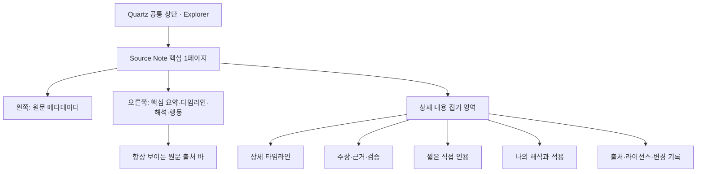

# Quartz v5 A형 혼합 리서치 노트 구현 명세

> [!abstract] 결정 사항
> Quartz의 기본 Explorer와 디지털 가든 기능은 유지한다. `type: source-note` 문서에만 B형 리서치 노트 디자인을 적용한다. 첫 화면은 핵심을 한 페이지 분량으로 보여주고, 상세 내용은 하단의 접기 영역으로 제공한다. 원문 출처와 이용 조건은 항상 눈에 보이도록 표시한다.

> [!important] 2026-08-09 사용자 승인 변경
> 이후 실제 화면 검토에서 사용자가 다음 항목을 최종 승인했다. 아래 결정은 이 문서의 기존 26%/74% 분할, Source Note 우측 레일 숨김, 출처 확인 바와 `원문에서 보기` 버튼 지시보다 우선한다.
>
> - Source Note 핵심 화면은 단일 읽기 열로 구성한다.
> - 출처 정보는 핵심 요약 뒤의 하단 카드 하나로 통합하고 중복 항목을 제거한다.
> - 출처 URL은 카드 안에서 한 번만 표시하며 별도 `원문 보기` 버튼은 두지 않는다.
> - Source Note에도 일반 문서와 동일한 오른쪽 TOC·Graph·Backlinks를 표시한다.
> - 마지막 callout은 출처 정보를 반복하지 않고 `변경 기록`만 담는다.
> - 전역 탐색과 브랜드의 최종 구조는 `docs/project/confirmed-requirements.md`를 따른다.

## 1. 문서 목적

이 문서는 다음 구현의 기준 명세다.

- AI·제조·코딩 자료를 YouTube, Threads, GitHub, 웹에서 수집한다.
- 공개 글의 첫 화면에서 핵심을 빠르게 파악할 수 있게 한다.
- 상세 근거와 개인 해석은 필요한 독자만 펼쳐볼 수 있게 한다.
- 원문과 직접 인용, 요약, 작성자의 해석을 명확히 구분한다.
- 출처 정보 누락을 빌드 전에 감지한다.
- Obsidian에서 편집하고 Quartz v5로 일관되게 렌더링한다.

이 명세는 기존 [[Obsidian Vault + Quartz v5 상세 구현 가이드]]의 콘텐츠 구조를 유지하면서, 공개 `source-note` 화면을 구체화한다.

## 2. 선택된 디자인

### 2.1 화면 방향

선택안은 **A형 혼합 리서치 노트**다.

- 전역 사이트: Quartz Explorer, 검색, Graph, Backlinks, 다크 모드 유지
- 일반 글: 기존 Quartz 콘텐츠 레이아웃
- Source Note: Explorer + 전용 핵심 요약 + 하단 접기 상세
- Source Note에서는 기본 ArticleTitle, ContentMeta, 오른쪽 TOC·Graph·Backlinks를 숨긴다.
- 모바일에서는 Explorer를 Quartz 기본 방식으로 처리하고, Source Note 내부 2단을 1단으로 전환한다.

### 2.2 핵심 화면 구조



## 3. 범위

### 포함

- `source-note` 전용 frontmatter
- YouTube, Threads, GitHub, Web Page 4종
- SourceNoteBrief 로컬 Quartz 컴포넌트 플러그인
- Source Note 조건부 레이아웃
- Obsidian 접기 Callout 기반 상세 섹션
- 출처 메타데이터 검증 스크립트
- 화면·모바일·인쇄 스타일
- 공개 전 체크리스트와 자동 검증

### 제외

- 원문 전체 자동 복제
- YouTube 전체 자막 공개
- Threads 게시물 전문 재게시
- 라이선스가 불명확한 GitHub 코드 복제
- 외부 사이트 이미지의 자동 다운로드·공개
- 법률 판단 자동화
- 댓글, 회원가입, 결제
- CMS 도입

## 4. UX 원칙

### 4.1 첫 화면은 결론 중심

독자는 첫 화면에서 다음을 알 수 있어야 한다.

1. 무엇을 다루는 자료인가
2. 원 출처는 누구인가
3. 핵심 결론은 무엇인가
4. 어떤 근거가 중요한가
5. 작성자는 어떻게 해석했는가
6. 다음에 무엇을 할 수 있는가

### 4.2 원문과 내 콘텐츠를 분리

다음 네 유형을 시각적으로 구분한다.

| 유형        | 라벨        | 표현 방식               |
| ----------- | ----------- | ----------------------- |
| 원문 사실   | 원문 정보   | 중립색                  |
| 원문의 주장 | 원문의 주장 | Source 색상 상단선      |
| 직접 인용   | 직접 인용   | 인용부호 + 위치 정보    |
| 작성자 해석 | 나의 해석   | 별도 배경과 명시적 라벨 |

### 4.3 상세 내용은 접기

- 핵심 1페이지 아래에 5개 접기 항목을 둔다.
- 1~4번은 기본 접힘이다.
- 5번 “출처·라이선스·변경 기록”은 기본 펼침이다.
- 제목만 읽어도 어떤 정보가 들어 있는지 알 수 있어야 한다.
- 접힌 내용도 HTML에 존재해 Quartz 검색과 접근성 트리에 포함되어야 한다.

## 5. 페이지 레이아웃

### 5.1 Desktop

```text
┌───────────────────────────────────────────────────────────┐
│ 공통 상단: 브랜드 · 주제 · 검색 · 보기                    │
├──────────────┬────────────────────────────────────────────┤
│ Quartz       │ Source Note 핵심 1페이지                   │
│ Explorer     │ ┌────────────┬───────────────────────────┐ │
│              │ │ 출처 메타  │ 핵심 요약                  │ │
│              │ │ 데이터     │ 타임라인·해석·다음 행동    │ │
│              │ └────────────┴───────────────────────────┘ │
│              │ 출처 확인 바                               │
│              ├────────────────────────────────────────────┤
│              │ 상세 내용 접기 5개                         │
└──────────────┴────────────────────────────────────────────┘
```

권장 비율:

- Quartz Explorer: Quartz 기본 폭
- Source Note 핵심 내부: 26% / 74%
- 핵심 영역 최대 폭: 1,050px
- 본문 최소 좌우 여백: 32px
- 제목 최대 폭: 760px

### 5.2 Tablet

- Source Note 내부 비율은 30% / 70%까지 허용한다.
- 제목 크기를 36px 이하로 줄인다.
- 다음 행동 카드는 3열에서 2열 또는 1열로 전환한다.

### 5.3 Mobile

- Source Note 내부를 한 열로 쌓는다.
- 출처 메타데이터가 핵심 본문 위에 온다.
- 긴 URL은 “원문에서 보기” 링크로 대체한다.
- 타임라인은 시간 56px + 본문 구조를 유지한다.
- 접기 제목에서 보조 설명을 숨긴다.
- 최소 터치 높이: 44px

### 5.4 Print

- 첫 인쇄 페이지: 핵심 1페이지
- Explorer, 상단 탐색, 검색, 다크 모드 버튼 숨김
- 핵심 영역을 A4 세로에 맞춤
- 출처 바를 첫 페이지 하단에 유지
- 상세 접기 내용은 모두 펼쳐 후속 페이지에 출력
- 접기 아이콘과 화면 전용 애니메이션 제거
- URL은 텍스트로도 식별 가능하게 출력

## 6. Source 유형별 디자인 토큰

| `source_type` | 표시명   | 강조색    | 상세 모듈               |
| ------------- | -------- | --------- | ----------------------- |
| `youtube`     | YouTube  | `#B25247` | 타임라인·발언 위치      |
| `threads`     | Threads  | `#5D554B` | 주장 전개·게시물 순서   |
| `github`      | GitHub   | `#3F6F5B` | 기능·구조·설치·라이선스 |
| `web`         | Web Page | `#4C718A` | 논지·근거·수치·최신성   |

색상만으로 유형을 구분하지 않는다. 유형명과 라벨을 반드시 함께 표시한다.

## 7. Vault 위치

```text
content/
├─ source-notes/
│  ├─ index.md
│  ├─ youtube/
│  ├─ threads/
│  ├─ github/
│  └─ web/
├─ ai/
├─ manufacturing/
└─ coding/

_templates/
└─ public-source-note.md

plugins/
└─ source-note-brief/
   ├─ package.json
   ├─ tsconfig.json
   ├─ tsup.config.ts
   └─ src/
      ├─ index.tsx
      ├─ schema.ts
      └─ styles.scss

scripts/
└─ validate-source-notes.mjs
```

비공개 원자료는 `_sources/`에 둔다. 공개 Source Note는 원자료를 그대로 이동하는 것이 아니라, 공개 가능한 요약과 해석만 `content/source-notes/`에 새로 작성한다.

## 8. Frontmatter 계약

### 8.1 완성 예시

```yaml
---
title: "제조 현장의 AI 에이전트는 어디서 시작해야 하는가"
description: "현장 데이터와 반복 업무를 연결하는 AI 에이전트의 현실적인 시작점을 정리합니다."
date: 2026-08-08
updated: 2026-08-08
publish: false
type: source-note
source_type: youtube
cssclasses:
  - source-note-page
topics:
  - ai
  - manufacturing
tags:
  - ai/agents
  - manufacturing/data
  - source/youtube
aliases: []
related:
  - "[[manufacturing/plm/data-quality]]"
service_relevance:
  - product-manufacturing-data
enableToc: false

source_title: "제조 AI 에이전트의 실제 시작점"
source_author: "현장의 AI"
source_publisher: "YouTube"
source_url: "https://www.youtube.com/watch?v=example"
source_published: 2026-07-28
source_published_status: confirmed
source_accessed: 2026-08-08
source_locator: "03:15–16:25"
source_language: ko
source_license: unknown
source_license_url: ""
source_usage: summary-and-short-quotation
permission_reference: ""

key_takeaway: "기술보다 먼저 반복 업무와 검증 가능한 데이터를 선택해야 한다."
source_claim: "에이전트는 데이터보다 업무 맥락을 먼저 이해해야 한다."
my_interpretation: "초기 성공은 모델 선택보다 문제 범위를 작게 자르는 능력에 달려 있다."

key_points:
  - at: "03:15"
    title: "좋은 시작점"
    summary: "작고 반복적이며 사람이 결과를 확인할 수 있는 업무를 선택한다."
  - at: "07:40"
    title: "데이터 연결"
    summary: "PLM과 품질 데이터를 하나의 업무 문맥으로 연결한다."
  - at: "12:10"
    title: "검증 기준"
    summary: "모델 정확도보다 의사결정 시간과 누락 감소를 측정한다."

next_actions:
  - "반복 업무 후보 3개 선정"
  - "필요 데이터와 담당자 연결"
  - "검증 지표와 승인 지점 정의"
---
```

### 8.2 필수 필드

`publish: true`인 `source-note`에는 다음 필드가 반드시 있어야 한다.

- `title`, `description`, `type: source-note`, `source_type`
- `source_title`, `source_author`, `source_url`
- `source_published` 또는 `source_published_status: unknown`
- `source_accessed`, `source_license`, `source_usage`
- `key_takeaway`, `source_claim`, `my_interpretation`
- `key_points` 1개 이상, `next_actions` 1개 이상

### 8.3 허용값

`source_published_status`:

- `confirmed`
- `unknown`

`source_license`:

- SPDX 식별자: `MIT`, `Apache-2.0`, `GPL-3.0-only` 등
- 별도 상태: `proprietary`, `all-rights-reserved`, `unknown`

`source_usage`:

- `link-only`
- `summary-only`
- `summary-and-short-quotation`
- `licensed-reuse`
- `permission-granted`

`unknown`은 재사용 허가가 아니다. 전문, 이미지, 코드, 긴 직접 인용은 공개하지 않는다.

### 8.4 첫 화면 콘텐츠 예산

한 페이지 요약을 유지하기 위해 다음 상한을 적용한다.

| 필드                | 권장 상한 |
| ------------------- | --------: |
| `title`             |      60자 |
| `description`       |     120자 |
| `key_takeaway`      |     120자 |
| `source_claim`      |     140자 |
| `my_interpretation` |     160자 |
| `key_points`        |  최대 3개 |
| `next_actions`      |  최대 3개 |

상한을 넘는 내용은 하단 상세 접기 영역으로 이동한다. Validator는 글자 수 초과를 경고하고, 목록 개수 초과는 한 페이지 구조를 깨뜨리므로 오류로 처리한다.

`key_points`처럼 객체가 들어 있는 중첩 YAML은 Obsidian Properties UI보다 Source mode에서 편집하는 것을 기준으로 한다. 템플릿 자동화 도구가 값을 생성할 때도 같은 YAML 구조를 유지한다.

## 9. 공개 Markdown 템플릿

파일: `_templates/public-source-note.md`

```markdown
---
title: "{{title}}"
description: ""
date: "{{date}}"
updated: "{{date}}"
publish: false
type: source-note
source_type: web
cssclasses:
  - source-note-page
topics: []
tags: []
aliases: []
related: []
service_relevance: []
enableToc: false

source_title: ""
source_author: ""
source_publisher: ""
source_url: ""
source_published:
source_published_status: unknown
source_accessed: "{{date}}"
source_locator: ""
source_language: ko
source_license: unknown
source_license_url: ""
source_usage: summary-only
permission_reference: ""

key_takeaway: ""
source_claim: ""
my_interpretation: ""
key_points: []
next_actions: []
---

> [!source-detail]- 01. 상세 타임라인과 구간별 요약
> 원문 전체를 복제하지 않고, 필요한 구간의 요지만 작성합니다.

> [!source-detail]- 02. 주장·근거·사실 검증
> 원문의 주장과 교차 검증한 공식 자료를 분리해서 기록합니다.

> [!source-detail]- 03. 짧은 직접 인용
>
> > [!quote] 직접 인용
> > 필요한 최소 범위의 문장만 사용합니다.
>
> > — 작성자, 원문 제목, 위치

> [!source-detail]- 04. 나의 해석과 현장 적용
> 이 영역은 원문이 아니라 작성자의 독자적인 해석입니다.

> [!source-detail]+ 05. 출처·라이선스·변경 기록
>
> - 원문: [원문 제목](https://example.com)
> - 작성자:
> - 게시일:
> - 확인일:
> - 원문 위치:
> - 라이선스:
> - 이용 범위:
> - 변경 기록:
```

## 10. 접기 영역 구현

접기 기능은 별도 JavaScript 아코디언보다 **Obsidian foldable callout**을 사용한다.

- Obsidian 편집·미리보기와 호환
- Quartz Obsidian Flavored Markdown과 호환
- 키보드 접근성 활용
- SPA 이동용 사용자 JavaScript 최소화
- 접힌 내용도 Markdown 원문에 존재

```scss
.source-note-page .callout[data-callout="source-detail"] {
  --callout-color: 178, 82, 71;
  margin: 0 0 0.75rem;
  border: 1px solid var(--lightgray);
  border-radius: 0;
  background: var(--light);
}

.source-note-page .callout[data-callout="source-detail"] > .callout-title {
  min-height: 3.25rem;
  padding: 0.85rem 1rem;
}

.source-note-page .callout[data-callout="source-detail"] > .callout-content {
  padding: 0 1rem 1rem;
}
```

## 11. SourceNoteBrief 컴포넌트

### 11.1 책임

`SourceNoteBrief`는 frontmatter만 읽어 핵심 1페이지를 렌더링한다.

입력:

- `fileData.frontmatter`
- Quartz 전역 색상·locale

출력:

- Source 유형 라벨
- 원문 메타데이터 측면단
- 제목·설명
- 한 문장 핵심
- 핵심 포인트
- 원문의 주장
- 나의 해석
- 다음 행동
- 항상 보이는 출처 확인 바

컴포넌트는 상세 Markdown이나 출처 원문을 가져오지 않는다.

### 11.2 실패 처리

- `type`이 `source-note`가 아니면 렌더링하지 않는다.
- 필수 값이 없고 `publish: false`이면 로컬 경고를 보여준다.
- 필수 값이 없고 `publish: true`이면 검증 스크립트가 빌드를 실패시킨다.
- 지원하지 않는 `source_type`은 중립색으로 렌더링하고 검증에서 경고한다.
- 긴 URL은 버튼 링크로만 표시한다.
- 외부 링크에 `rel="noopener noreferrer"`를 적용한다.

### 11.3 로컬 플러그인

```powershell
npx quartz plugin add ./plugins/source-note-brief
```

로컬 플러그인은 `.quartz/plugins/`에 연결된다. 저장소에는 `plugins/source-note-brief/` 원본과 `quartz.lock.json`을 함께 관리한다.

### 11.4 개념 코드

```tsx
import type {
  QuartzComponent,
  QuartzComponentConstructor,
  QuartzComponentProps,
} from "@quartz-community/types"
import { parseSourceNote } from "./schema"
import styles from "./styles.scss"

const SourceNoteBrief: QuartzComponentConstructor = () => {
  const Component: QuartzComponent = ({ fileData }: QuartzComponentProps) => {
    const note = parseSourceNote(fileData.frontmatter)
    if (!note) return null

    const className = "source-note-brief source-" + note.sourceType
    return (
      <section class={className}>
        <aside class="source-note-meta">
          <p class="source-note-type">{note.sourceTypeLabel}</p>
          <dl>
            <dt>원문 제목</dt>
            <dd>{note.sourceTitle}</dd>
            <dt>작성자</dt>
            <dd>{note.sourceAuthor}</dd>
            <dt>게시일</dt>
            <dd>{note.sourcePublishedLabel}</dd>
            <dt>확인일</dt>
            <dd>{note.sourceAccessed}</dd>
            <dt>원문 위치</dt>
            <dd>{note.sourceLocator}</dd>
            <dt>라이선스</dt>
            <dd>{note.sourceLicense}</dd>
          </dl>
        </aside>
        <div class="source-note-summary">
          <p class="source-note-kicker">SOURCE RESEARCH NOTE</p>
          <h1>{note.title}</h1>
          <p class="source-note-description">{note.description}</p>
          <section class="source-note-takeaway">
            <h2>한 문장 핵심</h2>
            <p>{note.keyTakeaway}</p>
          </section>
          <ol class="source-note-points">
            {note.keyPoints.map((point) => (
              <li>
                <time>{point.at}</time>
                <strong>{point.title}</strong>
                <span>{point.summary}</span>
              </li>
            ))}
          </ol>
          <div class="source-note-interpretation">
            <section>
              <h2>원문의 주장</h2>
              <p>{note.sourceClaim}</p>
            </section>
            <section>
              <h2>나의 해석</h2>
              <p>{note.myInterpretation}</p>
            </section>
          </div>
          <ul class="source-note-actions">
            {note.nextActions.map((action) => (
              <li>{action}</li>
            ))}
          </ul>
          <div class="source-note-origin">
            <p>{note.citationLabel}</p>
            <a href={note.sourceUrl} rel="noopener noreferrer">
              원문에서 보기
            </a>
          </div>
        </div>
      </section>
    )
  }

  Component.css = styles
  return Component
}

export default SourceNoteBrief
```

실제 구현에서는 `schema.ts`에서 frontmatter 타입과 URL을 정규화한다.

## 12. Quartz 조건부 레이아웃

Source Note:

- Explorer 유지
- SourceNoteBrief 표시
- 기본 ArticleTitle, ContentMeta, Breadcrumbs 숨김
- 오른쪽 TOC, Graph, Backlinks 숨김
- Markdown page body는 핵심 요약 아래에 렌더링

일반 글:

- 기존 Quartz 레이아웃 유지
- SourceNoteBrief 미표시

```typescript
import { loadQuartzConfig, loadQuartzLayout } from "./quartz/plugins/loader/config-loader"
import * as Component from "./quartz/components"
import * as ExternalPlugin from "./.quartz/plugins"

const config = await loadQuartzConfig()
export default config

export const layout = await loadQuartzLayout()

const isSourceNote = (props: Component.QuartzComponentProps) =>
  props.fileData.frontmatter?.type === "source-note"

const isRegularContent = (props: Component.QuartzComponentProps) =>
  props.fileData.frontmatter?.type !== "source-note"

const contentLayout = {
  ...layout.defaults,
  ...layout.byPageType.content,
}

const sourceNoteBrief = ExternalPlugin.SourceNoteBrief()

layout.byPageType.content = {
  ...contentLayout,
  beforeBody: [
    Component.ConditionalRender({
      component: sourceNoteBrief,
      condition: isSourceNote,
    }),
    ...(contentLayout.beforeBody ?? []).map((component) =>
      Component.ConditionalRender({
        component,
        condition: isRegularContent,
      }),
    ),
  ],
  right: (contentLayout.right ?? []).map((component) =>
    Component.ConditionalRender({
      component,
      condition: isRegularContent,
    }),
  ),
}
```

실제 구현에서는 설치된 v5 플러그인의 export 이름을 타입 검사로 확인하고 이름만 맞춘다.

## 13. `quartz.config.yaml` 요구사항

필수 기능:

- Obsidian Flavored Markdown
- Frontmatter
- ExplicitPublish
- Content Page
- Explorer
- Search
- SourceNoteBrief 로컬 컴포넌트

`npx quartz plugin add ./plugins/source-note-brief`가 만든 `source` 값을 유지한다.

```yaml
plugins:
  - source: "./plugins/source-note-brief"
    enabled: true
```

SourceNoteBrief는 `quartz.ts`에서 조건부 배치하므로 YAML `layout.position`을 중복 지정하지 않는다.

```yaml
plugins:
  - source: "@quartz-community/remove-draft"
    enabled: false
  - source: "@quartz-community/explicit-publish"
    enabled: true
```

`publish: true`가 없는 Source Note는 공개되지 않는다.

위 YAML 조각은 기존 `quartz.config.yaml`의 **하나의 `plugins` 목록에 병합**한다. `plugins:` 키를 여러 번 만들거나 생성된 설정 전체를 교체하지 않는다.

## 14. 출처 표시 계약

### 14.1 첫 화면 필수 표시

- 원문 유형
- 원문 제목
- 작성자 또는 채널
- 게시일
- 확인일
- 인용·요약한 위치
- 원문 링크
- 이용 원칙 요약

### 14.2 상세 출처 필수 표시

- 원문 URL 전체
- 게시자
- 라이선스 또는 “확인 불가”
- 이용 범위
- 허락 근거가 있다면 증빙 위치
- 최종 검토일
- 변경 기록

### 14.3 직접 인용

직접 인용은 다음을 모두 만족해야 한다.

- 인용부호 또는 인용 Callout 사용
- 작성자와 원문 제목 표시
- 타임스탬프, 게시물 순서, 파일·줄 또는 문단 등 위치 표시
- 설명에 필요한 최소 범위
- 내 문장이 인용보다 주된 분량

### 14.4 유형별 위치 표기

| 유형    | `source_locator` 예시               |
| ------- | ----------------------------------- |
| YouTube | `12:10–12:42`                       |
| Threads | `게시물 3/8`                        |
| GitHub  | `src/parser.ts:42` 또는 commit hash |
| Web     | `“Evaluation” 절, 4번째 문단`       |

## 15. 저작권·라이선스 운영 정책

> [!warning] 한계
> 이 정책은 위험을 줄이기 위한 운영 규칙이며 법률 자문이 아니다. 출처 표시는 이용 허락을 대신하지 않는다.

공개 원칙:

1. 원문 전문을 복제하지 않는다.
2. 요약과 비평, 직접 실험, 독자적인 해석을 중심으로 한다.
3. 직접 인용은 필요한 최소 범위만 사용한다.
4. 이미지, 영상 파일, 전체 자막, 전체 Threads 캡처는 별도 허락이나 라이선스가 없으면 공개하지 않는다.
5. YouTube는 원문 링크 또는 공식 임베드 기능을 사용한다.
6. GitHub는 공개 저장소라는 이유만으로 코드를 재사용하지 않는다.
7. `LICENSE`가 없으면 복제·배포·파생 사용 권한이 확인되지 않은 것으로 처리한다.
8. 허락이 불명확하면 `summary-only` 또는 `link-only`로 낮춘다.
9. 삭제·수정 요청을 받을 연락 방법을 Contact 페이지에 둔다.
10. 문제가 제기되면 해당 노트를 `publish: false`로 전환하고 검토한다.

관련 기준:

- [저작권법 제28조 공표된 저작물의 인용](https://law.go.kr/lsLinkCommonInfo.do?chrClsCd=010202&lsJoLnkSeq=1025517657)
- [저작권법 제37조 출처의 명시](https://www.law.go.kr/lsLinkCommonInfo.do?lsJoLnkSeq=1033063665)
- [YouTube Terms of Service](https://uk.youtube.com/t/terms)
- [GitHub Licensing a repository](https://docs.github.com/en/repositories/managing-your-repositorys-settings-and-features/customizing-your-repository/licensing-a-repository)

## 16. 출처 검증 스크립트

파일: `scripts/validate-source-notes.mjs`

### 16.1 검증 대상

- `content/**/*.md`
- `type: source-note`
- `publish: true`인 문서는 오류를 차단
- `publish: false`인 문서는 경고만 표시

### 16.2 오류 조건

- 필수 필드 누락
- `source_url`이 HTTP/HTTPS URL이 아님
- `source_accessed`가 날짜가 아님
- `source_type`이 허용 목록 밖
- `source_license`가 허용 목록 밖
- `source_usage`가 허용 목록 밖
- `key_points`가 비어 있음
- `next_actions`가 비어 있음
- `key_points` 또는 `next_actions`가 3개를 초과함
- `summary-and-short-quotation`인데 `source_locator`가 없음
- `licensed-reuse`인데 라이선스가 `unknown`
- `permission-granted`인데 `permission_reference`가 없음
- `source_published`가 없고 `source_published_status: unknown`도 없음

### 16.3 경고 조건

- 원문 게시일 확인 불가
- 원문 확인일이 180일보다 오래됨
- 외부 링크가 응답하지 않음
- 관련 글이 없음
- `service_relevance`가 있으나 관련 서비스 링크가 없음

외부 링크 응답 확인은 네트워크 실패로 전체 빌드를 막지 않고 경고로만 처리한다.

### 16.4 명령

```json
{
  "scripts": {
    "validate:sources": "node scripts/validate-source-notes.mjs",
    "build:verified": "npm run validate:sources && npx quartz build"
  }
}
```

GitHub Actions에서도 `npx quartz build` 전에 `npm run validate:sources`를 실행한다.

## 17. 접근성

- 모든 접기 제목은 키보드로 열고 닫을 수 있어야 한다.
- 접힘 상태를 색상만으로 표시하지 않는다.
- Source 유형 라벨을 텍스트로 표시한다.
- 링크 텍스트는 “여기” 대신 원문 성격을 설명한다.
- 라이트·다크 모드에서 본문 대비를 WCAG AA 수준으로 확인한다.
- 애니메이션은 `prefers-reduced-motion`에서 제거한다.
- 화면 낭독기에서 “원문의 주장”과 “나의 해석”이 구분되는 제목 구조를 사용한다.

## 18. 검색·Graph·Backlinks

- Source Note는 일반 콘텐츠처럼 검색 인덱스에 포함한다.
- 접힌 상세 내용도 검색 대상이어야 한다.
- `related` frontmatter만으로 Graph 연결을 기대하지 않는다.
- 공개 본문 하단에 실제 위키링크를 두어 Quartz가 링크를 수집하게 한다.

```markdown
## 관련 글

- [[manufacturing/plm/data-quality|PLM 데이터 품질]]
- [[ai/agents/agent-evaluation|AI 에이전트 평가 기준]]
```

## 19. 서비스 연결

`service_relevance`가 있을 때만 상세 4번 “나의 해석과 현장 적용” 아래에 짧은 연결을 둔다.

- 핵심 1페이지에는 판매성 CTA를 넣지 않는다.
- 상세 내용에서 문제와 서비스가 직접 연결될 때만 표시한다.
- 한 글에서 서비스 링크는 하나를 기본으로 한다.
- “문의하기”보다 진단 체크리스트나 관련 사례를 먼저 제공한다.
- 서비스 문장은 “나의 적용 제안” 아래에 둔다.

## 20. 성능

- SourceNoteBrief는 빌드 시 정적 HTML로 생성한다.
- 접기에는 별도 프레임워크 상태를 사용하지 않는다.
- 외부 폰트는 Quartz 설정 한 곳에서만 로드한다.
- 원문 미리보기 이미지는 기본적으로 로드하지 않는다.
- YouTube iframe은 기본 미표시로 시작한다.
- Graph와 검색 스크립트는 Quartz 기본 동작을 유지한다.

## 21. 테스트

### 21.1 단위 테스트

SourceNoteBrief:

- 각 `source_type`에 올바른 클래스가 붙는다.
- 필수 frontmatter가 렌더링된다.
- HTML 특수문자가 안전하게 이스케이프된다.
- 외부 URL이 링크로 생성된다.
- `type`이 다르면 렌더링하지 않는다.
- 누락 필드가 로컬 경고로 나타난다.

Validator:

- 정상 문서 통과
- 공개 문서 필수 필드 누락 실패
- 초안 문서 누락 경고
- 잘못된 URL 실패
- 잘못된 라이선스 실패
- 직접 인용 위치 누락 실패

### 21.2 빌드 테스트

```powershell
npm run validate:sources
npx quartz plugin install --from-config
npx quartz build
```

모든 명령이 종료 코드 0이어야 한다.

### 21.3 브라우저 테스트

확인 페이지:

- YouTube Source Note
- Threads Source Note
- GitHub Source Note
- Web Page Source Note
- 일반 article
- 폴더 index

확인 항목:

- 일반 글 레이아웃이 바뀌지 않음
- Source Note에만 전용 핵심 화면 표시
- 오른쪽 사이드바가 Source Note에서 숨겨짐
- 5개 접기 영역 동작
- Source 상세 영역 기본 펼침
- SPA 이동 후 접기 동작
- 검색 결과에서 접힌 상세 텍스트 검색
- 라이트·다크 모드
- 390px, 768px, 1440px 폭
- 인쇄 미리보기

### 21.4 시각 비교

승인된 A형 개선 목업과 실제 Quartz 화면을 같은 viewport에서 비교한다.

허용 가능한 차이:

- Quartz 실제 Explorer 폭
- 실제 한글 폰트 렌더링
- 콘텐츠 길이에 따른 높이

허용하지 않는 차이:

- 메타데이터와 핵심 본문의 순서 변경
- 출처 바 누락
- 원문의 주장과 나의 해석 구분 제거
- 상세 출처 기본 접힘
- 모바일 가로 스크롤

## 22. 구현 순서

### Phase 1 — 콘텐츠 계약

1. Frontmatter 타입과 허용값 확정
2. `public-source-note.md` 생성
3. 4개 Source 유형 샘플 Markdown 생성
4. 출처 validator 작성

완료 기준: 잘못된 공개 문서가 검증을 통과하지 못한다.

### Phase 2 — 전용 컴포넌트

1. 로컬 플러그인 scaffold
2. `schema.ts` 작성
3. SourceNoteBrief 렌더링
4. Source 유형별 토큰
5. 컴포넌트 단위 테스트

완료 기준: 4개 Source 유형이 동일한 구조와 각기 다른 강조색으로 렌더링된다.

### Phase 3 — Quartz 레이아웃 통합

1. 로컬 플러그인 설치
2. `quartz.ts` 조건부 레이아웃
3. 일반 글 회귀 확인
4. Source Note 오른쪽 사이드바 제거
5. Explorer 유지

완료 기준: Source Note만 A형으로 표시되고 일반 글은 기존 구조를 유지한다.

### Phase 4 — 상세·인쇄·접근성

1. Source Detail Callout 스타일
2. 모바일 반응형
3. 다크 모드
4. 인쇄 CSS
5. 키보드·화면 낭독기 확인

완료 기준: 화면, 모바일, 인쇄에서 정보 손실이 없다.

### Phase 5 — 배포 검증

1. CI에 validator 추가
2. Quartz 프로덕션 빌드
3. GitHub Pages preview
4. 외부 링크·RSS·sitemap 확인

완료 기준: 검증 실패 문서는 배포되지 않고, 정상 Source Note만 공개된다.

## 23. 파일별 구현 책임

| 파일                                        | 책임                        |
| ------------------------------------------- | --------------------------- |
| `_templates/public-source-note.md`          | 공개 문서 작성 계약         |
| `plugins/source-note-brief/src/schema.ts`   | frontmatter 정규화·타입     |
| `plugins/source-note-brief/src/index.tsx`   | 핵심 1페이지 렌더링         |
| `plugins/source-note-brief/src/styles.scss` | 전용 화면·반응형·인쇄       |
| `scripts/validate-source-notes.mjs`         | 공개 전 출처 검증           |
| `quartz.ts`                                 | Source Note 조건부 레이아웃 |
| `quartz.config.yaml`                        | 플러그인과 공개 필터        |
| `quartz/styles/custom.scss`                 | 사이트 공통 브랜드 스타일   |
| `content/source-notes/index.md`             | Source Notes 소개·목록      |

## 24. 완료 조건

1. `type: source-note` 문서에만 A형 화면이 적용된다.
2. 일반 article은 기존 Quartz 레이아웃을 유지한다.
3. 첫 화면에 핵심 요약과 출처가 함께 보인다.
4. 원문의 주장과 나의 해석이 분리된다.
5. 상세 내용 5개가 접기 형태로 동작한다.
6. 출처·라이선스 영역은 기본 펼침이다.
7. 필수 출처가 없는 공개 문서는 빌드 전에 실패한다.
8. YouTube, Threads, GitHub, Web Page 샘플이 모두 렌더링된다.
9. 모바일에서 한 열로 전환되고 가로 스크롤이 없다.
10. 인쇄 첫 페이지에 핵심 요약과 출처가 들어간다.
11. 검색에서 접힌 상세 내용이 검색된다.
12. 라이트·다크 모드에서 대비와 강조색이 정상이다.
13. GitHub Pages 프로덕션 빌드가 성공한다.

## 25. 구현 시 변경하지 않을 결정

- A형 혼합 레이아웃 사용
- Explorer 유지
- Source Note 오른쪽 사이드바 숨김
- 핵심 1페이지 후 상세 접기
- Source 상세 기본 펼침
- Explicit Publish 사용
- 원문 전문 자동 공개 금지
- 출처 validator를 배포 단계에 포함
- 서비스 홍보는 상세 영역에서 관련 있을 때만 표시

## 26. 공식 참고 자료

- [Quartz v5 Configuration](https://quartz.jzhao.xyz/configuration)
- [Quartz v5 Layout](https://quartz.jzhao.xyz/layout)
- [Quartz v5 Creating Component Plugins](https://quartz.jzhao.xyz/advanced/creating-components)
- [Quartz v5 Frontmatter](https://quartz.jzhao.xyz/plugins/Frontmatter)
- [Quartz v5 Private Pages](https://quartz.jzhao.xyz/features/private-pages)
- [Quartz v5 Plugin CLI](https://quartz.jzhao.xyz/cli/plugin)
- [Obsidian Callouts](https://help.obsidian.md/callouts)
- [저작권법 제28조](https://law.go.kr/lsLinkCommonInfo.do?chrClsCd=010202&lsJoLnkSeq=1025517657)
- [저작권법 제37조](https://www.law.go.kr/lsLinkCommonInfo.do?lsJoLnkSeq=1033063665)
- [YouTube Terms of Service](https://uk.youtube.com/t/terms)
- [GitHub Licensing a repository](https://docs.github.com/en/repositories/managing-your-repositorys-settings-and-features/customizing-your-repository/licensing-a-repository)
