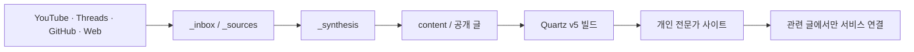
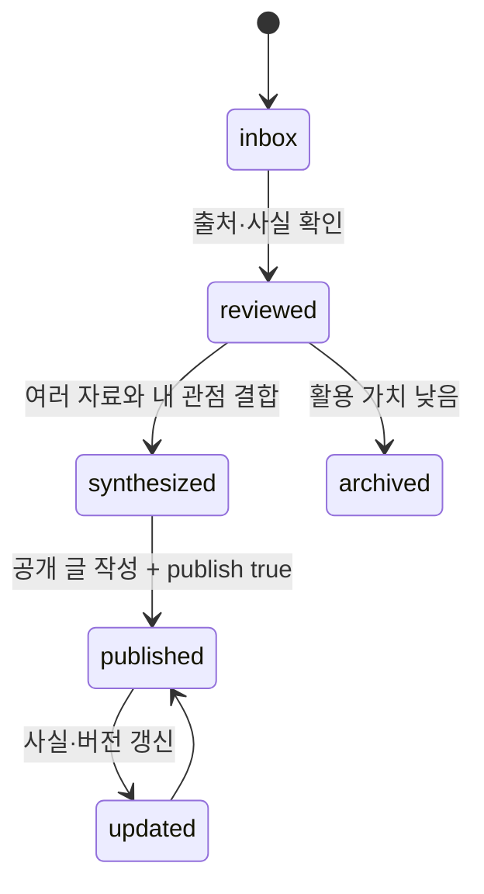

# Obsidian Vault + Quartz v5 상세 구현 가이드

> 대상: AI · 제조 · 코딩 지식을 축적하고, 관련 문맥에서 ICT People의 서비스를 자연스럽게 소개하는 개인 전문가 브랜드
>
> 기준일: 2026-08-08  
> 권장 운영 비중: 개인 지식·인사이트 70% / 서비스·프로젝트 30%

## 1. 최종 설계 결정

이 사이트는 “회사 홈페이지를 개인 블로그에 복제”하는 구조가 아니라, 다음 세 층으로 운영한다.

1. **개인 지식 저장소**: YouTube, Threads, GitHub, 웹 문서를 수집하고 검토한다.
2. **전문가 퍼블리싱 사이트**: AI, 제조, 코딩을 연결해 해설·튜토리얼·비교·프로젝트 글을 발행한다.
3. **서비스 연결 지점**: 글의 문제와 서비스가 실제로 연결될 때만 PLM, ALM, LIMS, R&D·시스템 구축 역량을 소개한다.

핵심 원칙은 **비공개 연구 자료와 공개 콘텐츠를 폴더 단계에서 분리**하는 것이다. Quartz는 `content/`만 빌드 대상으로 삼고, 수집 자료와 초안은 그 밖에 둔다.



## 2. 권장 기술 구성

- 편집기: Obsidian
- 사이트 생성기: Quartz v5
- 원본 관리: Git + GitHub
- 호스팅: GitHub Pages
- 콘텐츠 형식: Obsidian Flavored Markdown + YAML frontmatter
- 공개 기준: `publish: true`인 문서만 발행
- 로컬 미리보기: `npx quartz build --serve`

Quartz v5는 Node.js 22 이상과 npm 10.9.2 이상을 요구한다. 새 설치는 Quartz 공식 GitHub 템플릿을 사용하고 `npx quartz create`에서 `obsidian` 템플릿을 선택하는 흐름을 권장한다.

## 3. 설치 전 준비

Windows PowerShell에서 버전을 확인한다.

```powershell
node --version
npm --version
git --version
```

권장 최소 조건:

- Node.js: 22 이상
- npm: 10.9.2 이상
- Git: 현재 지원 버전
- GitHub 계정 및 새 저장소

## 4. Quartz v5 프로젝트 생성

### 4.1 GitHub 템플릿으로 시작

Quartz 공식 저장소의 “Use this template” 기능으로 새 저장소를 만든다. 예시는 `my-digital-garden`으로 표기한다.

```powershell
git clone https://github.com/<github-user>/my-digital-garden.git
Set-Location my-digital-garden
npm install
npx quartz create
```

초기 질문에는 다음처럼 답한다.

- template: `obsidian`
- content strategy: `new`
- GitHub Pages 배포: 사용

기존 Obsidian 볼트가 따로 있고 그대로 유지해야 한다면 `copy` 또는 `symlink` 전략을 검토할 수 있다. 이 가이드에서는 관리가 가장 단순한 **Quartz 저장소 자체를 Obsidian 볼트로 여는 방식**을 기준으로 한다.

### 4.2 플러그인 설치 및 최초 실행

```powershell
npx quartz plugin install --from-config
npx quartz build --serve
```

브라우저에서 `http://localhost:8080`을 열어 최초 화면을 확인한다.

## 5. 권장 Vault/Repository 폴더 구조

```text
my-digital-garden/
├─ .obsidian/                      # Obsidian 설정
├─ _inbox/                         # 분류 전 메모와 URL
├─ _sources/                       # 출처별 원자료 노트
│  ├─ youtube/
│  ├─ threads/
│  ├─ github/
│  └─ web/
├─ _synthesis/                     # 여러 출처를 연결한 비공개 합성 노트
├─ _templates/                     # Obsidian 템플릿 6종
├─ _attachments-private/           # 공개하면 안 되는 이미지·PDF·캡처
├─ content/                        # Quartz가 공개하는 유일한 콘텐츠 영역
│  ├─ index.md                     # 홈
│  ├─ ai/
│  │  ├─ index.md
│  │  ├─ agents/
│  │  ├─ llm/
│  │  └─ automation/
│  ├─ manufacturing/
│  │  ├─ index.md
│  │  ├─ plm/
│  │  ├─ smart-factory/
│  │  └─ quality/
│  ├─ coding/
│  │  ├─ index.md
│  │  ├─ python/
│  │  ├─ web/
│  │  └─ dev-tools/
│  ├─ projects/
│  │  ├─ index.md
│  │  └─ case-studies/
│  ├─ services/
│  │  ├─ index.md
│  │  ├─ product-manufacturing-data.md
│  │  ├─ development-process.md
│  │  ├─ lab-quality-digitalization.md
│  │  └─ custom-platform-system.md
│  ├─ assets/                       # 공개 가능한 이미지·첨부 파일만
│  │  ├─ ai/
│  │  ├─ manufacturing/
│  │  ├─ coding/
│  │  └─ brand/
│  ├─ about.md
│  └─ contact.md
├─ quartz/
│  └─ styles/
│     └─ custom.scss
├─ quartz.config.yaml
├─ quartz.ts
├─ package.json
└─ .github/
   └─ workflows/
      └─ deploy.yml
```

### 5.1 폴더의 역할

| 폴더                    | 공개 여부 | 용도                                            |
| ----------------------- | --------: | ----------------------------------------------- |
| `_inbox/`               |    비공개 | 링크, 짧은 메모, 정리 전 아이디어               |
| `_sources/`             |    비공개 | 출처별 사실·인용·타임스탬프·검토 메모           |
| `_synthesis/`           |    비공개 | 여러 자료를 비교하고 내 관점을 만드는 중간 노트 |
| `_templates/`           |    비공개 | 콘텐츠 작성 양식                                |
| `_attachments-private/` |    비공개 | 다운로드한 자료, 캡처, 원본 이미지              |
| `content/`              | 공개 후보 | 실제 사이트에 나갈 글과 공개 자산               |

## 6. 공개와 비공개의 안전 경계

Quartz의 필터만 믿어서는 안 된다. GitHub 저장소가 공개이면 Quartz가 빌드하지 않은 파일도 저장소에서 직접 읽을 수 있기 때문이다.

`.gitignore`에 최소한 다음을 넣는다.

```gitignore
# Private knowledge-work area
_inbox/
_sources/
_synthesis/
_templates/
_attachments-private/

# Local Obsidian state
.obsidian/workspace.json
.obsidian/workspace-mobile.json
.obsidian/cache/

# Local build artifacts
public/
.quartz/cache/
```

추가 원칙:

- 공개 가능한 Markdown은 `content/` 안으로 **복사하거나 새로 작성**한다.
- 공개 이미지는 `content/assets/`에만 둔다.
- 유료 자료, 사내 문서, 고객 정보, 개인 토큰은 저장소에 넣지 않는다.
- 공개 저장소에 한 번 올라간 비밀은 삭제 커밋만으로 완전히 회수되지 않는다.
- 실수 방지를 위해 Quartz의 `ExplicitPublish` 필터를 사용한다.

## 7. 파일 이름과 URL 규칙

파일 이름은 영문 소문자 kebab-case를 기본으로 한다.

```text
좋음: ai-agent-evaluation-guide.md
좋음: 2026-08-08-gpt-manufacturing-review.md
피함: AI 에이전트 최종최종.md
피함: new_note_7.md
```

운영 규칙:

- 제목은 frontmatter의 `title`에 자연스러운 한국어로 쓴다.
- 에버그린 글은 날짜를 파일명에 넣지 않는다.
- 뉴스·버전 리뷰·행사 기록은 `YYYY-MM-DD-slug.md`를 쓸 수 있다.
- 경로를 자주 바꿀 가능성이 있으면 `permalink`를 지정한다.
- 폴더마다 `index.md`를 만들어 폴더 소개와 대표 글을 제공한다.

## 8. 분류 체계

폴더는 “주제의 집”, 태그는 “주제를 가로지르는 속성”으로 사용한다.

### 8.1 1차 주제

- `ai`: LLM, 에이전트, RAG, 자동화, AI 활용법
- `manufacturing`: PLM, 스마트 제조, 품질, 연구개발 데이터
- `coding`: Python, 웹, 도구, 자동화, 개발 워크플로
- `projects`: 직접 만든 도구, 실험, 사례
- `services`: 문제 유형별 서비스 설명

### 8.2 권장 태그 예시

```yaml
tags:
  - ai/agents
  - manufacturing/plm
  - coding/automation
  - source/github
  - format/tutorial
```

한 글에 태그는 보통 3~6개로 제한한다. 폴더명과 같은 태그를 무조건 중복하지 않는다.

## 9. 공개 문서 공통 frontmatter

```yaml
---
title: "문서 제목"
description: "검색 결과와 공유 카드에 표시할 1~2문장"
date: 2026-08-08
updated: 2026-08-08
publish: false
type: article
topics:
  - ai
tags:
  - ai/agents
aliases: []
related: []
service_relevance: []
source_urls: []
enableToc: true
---
```

필드 기준:

| 필드                | 필수 | 설명                                |
| ------------------- | ---: | ----------------------------------- |
| `title`             |   예 | 화면과 탐색기에 표시할 제목         |
| `description`       |   예 | 검색·RSS·공유용 요약                |
| `date`              |   예 | 최초 발행일                         |
| `updated`           | 권장 | 큰 수정이 있었던 날짜               |
| `publish`           |   예 | `true`일 때만 공개                  |
| `type`              |   예 | article, project, service, index 등 |
| `topics`            | 권장 | 1차 주제                            |
| `tags`              | 권장 | 교차 분류                           |
| `aliases`           | 선택 | 다른 이름으로 연결할 때             |
| `related`           | 선택 | 관련 내부 문서                      |
| `service_relevance` | 선택 | 연결 가능한 서비스 영역             |
| `source_urls`       | 권장 | 원 출처 URL                         |
| `enableToc`         | 선택 | 긴 글의 목차 표시                   |

`related`에 위키링크를 넣을 때는 YAML 파싱 안전성을 위해 문자열로 감싼다.

```yaml
related:
  - "[[ai/agents/agent-evaluation]]"
  - "[[manufacturing/plm/data-quality]]"
```

## 10. Obsidian 설정

Obsidian에서 저장소 루트를 “Open folder as vault”로 연다.

### Files & Links

- Automatically update internal links: 켬
- Use `[[Wikilinks]]`: 켬
- Default location for new notes: `_inbox`
- Default location for new attachments: `_attachments-private`
- New link format: Shortest path when possible

### Core plugins

- Templates: 켬, Template folder = `_templates`
- Properties view: 켬
- Backlinks: 켬
- Outgoing links: 켬
- Tags view: 켬

공개 첨부 파일은 자동 첨부 폴더에 맡기지 말고, 검토 후 `content/assets/<topic>/`으로 옮긴다. 글에서는 다음처럼 삽입한다.

```markdown
![[assets/ai/agent-workflow.webp]]
```

외부 사이트는 표준 Markdown 링크를 쓴다.

```markdown
[Quartz 공식 문서](https://quartz.jzhao.xyz/)
```

## 11. 템플릿 6종

템플릿 파일은 `_templates/`에 둔다. 아래의 `{{date}}`, `{{title}}`은 Obsidian Templates 플러그인 치환 값을 기준으로 한 예시다.

### 11.1 YouTube 수집 템플릿 — `source-youtube.md`

```markdown
---
title: "{{title}}"
type: source
source_type: youtube
source_url: ""
channel: ""
published_at:
captured_at: "{{date}}"
status: inbox
topics: []
tags:
  - source/youtube
service_relevance: []
copyright_note: "요약과 짧은 인용만 사용"
---

# {{title}}

## 한 줄 판단

이 영상을 왜 저장했는가?

## 핵심 내용

-
-
-

## 타임스탬프 메모

- 00:00 —
- 00:00 —

## 검증이 필요한 주장

- [ ]

## 내 해석

원문 요약과 나의 판단을 구분해서 작성한다.

## 활용 후보

- [ ] 독립 글
- [ ] 기존 글 보강
- [ ] 프로젝트 아이디어
- [ ] 서비스 문맥

## 관련 노트

-
```

### 11.2 Threads 수집 템플릿 — `source-thread.md`

```markdown
---
title: "{{title}}"
type: source
source_type: threads
source_url: ""
author: ""
published_at:
captured_at: "{{date}}"
status: inbox
topics: []
tags:
  - source/threads
service_relevance: []
---

# {{title}}

## 원문 요지

짧게 재서술한다. 원문 전체를 복제하지 않는다.

## 맥락

- 이 주장이 나온 배경:
- 댓글이나 후속 글에서 보완된 내용:

## 사실 / 의견 구분

### 확인 가능한 사실

-

### 작성자의 의견

-

### 내 의견

-

## 추가 검증 링크

-

## 콘텐츠로 발전시킬 질문

-
```

### 11.3 GitHub 수집 템플릿 — `source-github.md`

````markdown
---
title: "{{title}}"
type: source
source_type: github
source_url: ""
repository: ""
license: ""
default_branch: ""
captured_at: "{{date}}"
status: inbox
topics: []
tags:
  - source/github
service_relevance: []
---

# {{title}}

## 무엇을 해결하는 저장소인가

## 빠른 평가

- 유용성:
- 학습 난이도:
- 유지보수 상태:
- 우리 환경 적용 가능성:

## 구조

- 주요 언어:
- 핵심 디렉터리:
- 진입점:
- 설치 방식:

## 실행 기록

```text
실행 명령과 결과를 기록한다.
```
````

## 인상적인 구현

- 파일/경로:
- 이유:

## 주의점

- 라이선스:
- 보안:
- 버전 의존성:
- 검증하지 못한 부분:

## 내 프로젝트에 적용할 아이디어

-

## 관련 노트

-

````

### 11.4 웹 문서 수집 템플릿 — `source-web.md`

```markdown
---
title: "{{title}}"
type: source
source_type: web
source_url: ""
site_name: ""
author: ""
published_at:
updated_at:
captured_at: "{{date}}"
status: inbox
topics: []
tags:
  - source/web
service_relevance: []
---

# {{title}}

## 3문장 요약

1.
2.
3.

## 핵심 근거

- 주장:
  - 근거:
  - 신뢰 수준:

## 중요한 용어

- 용어:
  - 의미:

## 최신성 확인

- 문서 날짜:
- 현재도 유효한가:
- 공식 문서와 교차 확인했는가:

## 내 해석과 활용

-

## 추가 출처

-
````

### 11.5 합성 노트 템플릿 — `synthesis.md`

```markdown
---
title: "{{title}}"
type: synthesis
created: "{{date}}"
updated: "{{date}}"
status: developing
topics: []
tags:
  - format/synthesis
service_relevance: []
candidate_path: ""
---

# {{title}}

## 중심 질문

이 노트가 답하려는 질문은 무엇인가?

## 잠정 결론

아직 확정하지 않은 결론을 3~5문장으로 쓴다.

## 출처별 관점

| 출처 | 핵심 주장 | 근거 | 한계 |
| ---- | --------- | ---- | ---- |
|      |           |      |      |

## 공통점

-

## 차이와 충돌

-

## 나의 관점

출처에 없는 나만의 해석, 경험, 판단을 명시한다.

## 독자에게 줄 실용적 결과

- 체크리스트:
- 예제:
- 의사결정 기준:

## 서비스 연결 검토

- 독자의 문제가 실제 서비스와 이어지는가?
- 연결한다면 어떤 서비스인가?
- 홍보가 아니라 다음 행동으로 자연스럽게 이어지는가?

## 공개 글 개요

1. 문제
2. 배경
3. 핵심 설명
4. 비교 또는 예제
5. 적용 방법
6. 한계
7. 관련 서비스 또는 다음 읽을 글

## 사용 출처

-
```

### 11.6 공개 글 템플릿 — `article.md`

```markdown
---
title: "{{title}}"
description: ""
date: "{{date}}"
updated: "{{date}}"
publish: false
type: article
topics: []
tags: []
aliases: []
related: []
service_relevance: []
source_urls: []
enableToc: true
---

# {{title}}

> [!abstract] 이 글의 핵심
> 독자가 20초 안에 얻을 결론을 2~3문장으로 적는다.

## 이런 분에게 유용합니다

-

## 문제 또는 배경

## 핵심 개념

## 실제 적용 방법

### 1단계

### 2단계

### 3단계

## 예제 또는 비교

## 내가 직접 확인한 것

- 확인 환경:
- 확인 결과:
- 확인하지 못한 범위:

## 주의점과 한계

> [!warning] 적용 전 확인
> 버전, 비용, 보안, 저작권 등 독자가 알아야 할 제약을 쓴다.

## 정리

## 관련 서비스

`service_relevance`가 비어 있으면 이 절을 삭제한다. 관련이 있을 때도 2~4문장과 하나의 명확한 링크만 사용한다.

## 관련 글

-

## 출처

-
```

## 12. 콘텐츠 상태와 이동 규칙

콘텐츠는 다음 네 상태를 거친다.



상태별 기준:

- `inbox`: URL과 저장 이유가 있다.
- `reviewed`: 핵심 내용, 근거, 최신성, 저작권 주의를 확인했다.
- `synthesized`: 최소 2개 이상의 근거 또는 직접 실험을 연결했고 내 관점이 있다.
- `published`: 공개 체크리스트를 통과하고 `content/`에 있으며 `publish: true`다.
- `archived`: 현재는 쓰지 않지만 삭제할 필요는 없다.

## 13. 홈과 주요 섹션 설계

### 13.1 홈 `content/index.md`

홈은 회사 소개가 아니라 “이 사람이 무엇을 탐구하고 어떤 문제를 풀 수 있는가”를 먼저 보여준다.

권장 순서:

1. 한 문장 전문가 포지셔닝
2. AI · 제조 · 코딩 세 개 주제 입구
3. 최신 글
4. 대표 프로젝트
5. “이런 문제를 함께 해결합니다” 서비스 연결
6. About / Contact

예시 문구:

```markdown
---
title: "AI · 제조 · 코딩을 연결하는 실전 지식"
description: "복잡한 기술과 제조 현장의 문제를 이해하고, 작동하는 도구와 시스템으로 연결합니다."
publish: true
type: index
---

# 기술을 이해하고, 현장에 적용하고, 작동하는 시스템으로 만듭니다

AI, 제조 데이터, 코딩 도구를 탐구하며 실무에 적용 가능한 방식으로 정리합니다.

## 탐구 분야

- [[ai/index|AI]]
- [[manufacturing/index|제조]]
- [[coding/index|코딩]]

## 프로젝트

직접 만든 도구와 적용 기록은 [[projects/index|프로젝트]]에서 볼 수 있습니다.

## 함께 해결할 수 있는 문제

제품·제조 데이터, 개발 프로세스, 연구실·품질 데이터, 맞춤형 플랫폼 구축이 필요하다면 [[services/index|서비스]]를 확인하세요.
```

### 13.2 폴더 index

Quartz는 폴더 목록 페이지를 자동 생성하지만, 각 폴더에 `index.md`를 두면 제목·설명·대표 링크를 직접 설계할 수 있다.

```markdown
---
title: "AI"
description: "LLM, 에이전트, RAG, 자동화를 실무 관점에서 탐구합니다."
publish: true
type: index
---

# AI

도구 소개를 넘어, 언제 유효하고 어떻게 검증할지에 초점을 둡니다.

## 시작하기

- [[ai/agents/agent-evaluation-guide|AI 에이전트 평가 가이드]]
```

## 14. 서비스 영역의 콘텐츠 구조

서비스는 제품명을 나열하기보다 고객 문제를 기준으로 묶는다.

| 공개 섹션            | 문제                                           | 연결 가능한 역량                |
| -------------------- | ---------------------------------------------- | ------------------------------- |
| 제품·제조 데이터     | 제품 정보가 분산되고 변경 이력이 연결되지 않음 | 3DPLM, 3DEXPERIENCE, SmartEnter |
| 개발 프로세스        | 요구사항·테스트·결함·릴리스가 단절됨           | ALM                             |
| 연구실·품질 디지털화 | 시험·분석·품질 기록이 수작업으로 분산됨        | LIMS                            |
| 맞춤형 플랫폼·시스템 | 기존 도구로 해결되지 않는 업무 흐름            | R&D, 인프라, 시스템 통합        |

글 속 서비스 연결 규칙:

- `service_relevance`가 없으면 서비스 문단을 넣지 않는다.
- 문제 해결 과정과 직접 관련된 서비스 하나만 우선 연결한다.
- “문의하세요”보다 진단 질문이나 체크리스트를 먼저 제공한다.
- 동일한 CTA를 모든 글에 반복하지 않는다.
- 서비스 글에서도 기술적 근거와 적용 범위를 명확히 쓴다.

## 15. Quartz v5 구성 전략

Quartz v5는 기본 설정을 `quartz.config.yaml`에 두고, 고급 콜백이나 JavaScript 함수가 필요한 경우에만 `quartz.ts`를 사용한다.

중요: 아래 예시는 `npx quartz create`가 생성한 파일을 통째로 덮어쓰라는 뜻이 아니다. **생성된 v5 설정에서 해당 항목만 병합**한다. 특히 플러그인 `source` 이름은 설치 시점의 생성 결과를 유지한다.

### 15.1 `configuration` 권장값

```yaml
configuration:
  pageTitle: "기술을 연결하는 사람"
  pageTitleSuffix: " | AI · 제조 · 코딩"
  enableSPA: true
  enablePopovers: true
  analytics: null
  locale: ko-KR

  # 사용자 사이트: <github-user>.github.io
  # 프로젝트 사이트: <github-user>.github.io/<repository>
  # 프로토콜(https://)은 쓰지 않는다.
  baseUrl: "<github-user>.github.io/<repository>"

  ignorePatterns:
    - "private"
    - "templates"
    - ".obsidian"

  theme:
    fontOrigin: googleFonts
    cdnCaching: true
    typography:
      title: "Noto Sans KR"
      header: "Noto Sans KR"
      body: "Noto Sans KR"
      code: "IBM Plex Mono"
    colors:
      lightMode:
        light: "#f7f8fa"
        lightgray: "#e7eaf0"
        gray: "#9aa3b2"
        darkgray: "#364152"
        dark: "#121826"
        secondary: "#3157d5"
        tertiary: "#0f8a7b"
        highlight: "rgba(49, 87, 213, 0.14)"
        textHighlight: "#fff0a6"
      darkMode:
        light: "#121722"
        lightgray: "#252c3a"
        gray: "#778196"
        darkgray: "#c5ccda"
        dark: "#f4f7fb"
        secondary: "#8aa4ff"
        tertiary: "#62d6c5"
        highlight: "rgba(138, 164, 255, 0.18)"
        textHighlight: "#6a5a1d"
```

### 15.2 플러그인 권장 구성

생성된 v5 기본 설정에서 다음 기능을 유지한다.

**변환**

- Obsidian Flavored Markdown
- GitHub Flavored Markdown
- Syntax Highlighting
- Created/Modified Date
- Table of Contents
- Crawl Links
- Description

**필터**

- `ExplicitPublish`: 활성화
- `RemoveDrafts`: 비활성화

이 사이트는 연구 볼트와 공개 사이트를 함께 쓰므로 “초안만 제외”보다 “명시적으로 승인한 글만 공개”가 안전하다.

개념적인 병합 예시는 다음과 같다. Quartz v5의 `plugins`는 종류별 하위 목록이 아니라 **하나의 평면 목록**이다. 실제 `source` 값과 옵션 키는 생성된 v5 설정을 우선한다.

```yaml
plugins:
  - source: "@quartz-community/remove-draft"
    enabled: false
  - source: "@quartz-community/explicit-publish"
    enabled: true
```

**출력**

- Content Index: sitemap + RSS
- Folder Pages
- Tag Pages
- Content Pages
- Explorer
- Search
- Graph
- Backlinks
- Article Title
- Content Meta
- Breadcrumbs
- Dark Mode
- Reader Mode
- Footer
- Note Properties

초기 버전에서는 Recent Notes를 억지로 커스텀하지 않는다. 먼저 발행 글이 6~10개 쌓인 뒤 홈 전용 최신 글 영역을 추가하는 편이 좋다.

### 15.3 Explorer 권장값

```yaml
options:
  title: "둘러보기"
  folderClickBehavior: link
  folderDefaultState: collapsed
  useSavedState: true
```

고급 정렬·숨김·이름 변환은 `quartz.ts`의 콜백으로 옮긴다. 1차 구현에서는 폴더 구조와 `index.md` 제목만으로 충분하다.

### 15.4 `quartz.ts` 운영 원칙

초기에는 생성된 기본 파일을 그대로 둔다.

```typescript
import { loadQuartzConfig, loadQuartzLayout } from "./quartz/plugins/loader/config-loader"

const config = await loadQuartzConfig()
export default config
export const layout = await loadQuartzLayout()
```

다음 요구가 생길 때만 고급 설정을 추가한다.

- `_`로 시작하는 폴더를 탐색기에서 추가 필터링
- 서비스 폴더를 탐색기 하단에 고정
- 글 유형별 정렬
- 사용자 정의 홈 컴포넌트
- 서비스 관련 글 자동 추천

## 16. 세련된 UI를 위한 `custom.scss` 시작점

Quartz v5의 `quartz/styles/custom.scss`에 다음 스타일을 병합한다. 기본 테마 변수를 활용하므로 라이트·다크 모드와 함께 작동하도록 설계한다.

```scss
@use "./variables.scss" as *;

:root {
  --brand-radius-sm: 10px;
  --brand-radius-md: 16px;
  --brand-shadow: 0 12px 40px rgba(22, 32, 54, 0.08);
}

body {
  letter-spacing: -0.012em;
}

.page-title {
  font-weight: 760;
  letter-spacing: -0.035em;
}

article {
  line-height: 1.78;
}

article h1,
article h2,
article h3 {
  letter-spacing: -0.025em;
  text-wrap: balance;
}

article img {
  border-radius: var(--brand-radius-md);
  box-shadow: var(--brand-shadow);
}

.callout {
  border-radius: var(--brand-radius-sm);
}

code,
pre {
  font-variant-ligatures: none;
}

a.internal {
  text-underline-offset: 0.2em;
  text-decoration-thickness: 0.08em;
}

@media all and ($mobile) {
  article {
    line-height: 1.72;
  }
}
```

UI 원칙:

- 홈에서만 강한 브랜드 메시지를 사용한다.
- 본문은 장식보다 가독성을 우선한다.
- 카드, 둥근 모서리, 그림자는 홈·프로젝트·서비스 영역에 제한한다.
- 본문 너비는 지나치게 넓히지 않는다.
- 강조색은 1개, 보조색은 1개로 제한한다.
- 아이콘은 의미가 있을 때만 쓴다.

## 17. GitHub Pages 배포

공식 Quartz v5 호스팅 가이드 기준의 워크플로 구조다. 생성된 템플릿의 워크플로가 더 최신이면 그 파일을 우선한다.

```yaml
name: Deploy Quartz site to GitHub Pages

on:
  push:
    branches:
      - v5
  workflow_dispatch:

permissions:
  contents: read
  pages: write
  id-token: write

concurrency:
  group: pages
  cancel-in-progress: false

jobs:
  build:
    runs-on: ubuntu-latest
    steps:
      - uses: actions/checkout@v6
        with:
          fetch-depth: 0
      - uses: actions/setup-node@v6
        with:
          node-version: 24
      - name: Cache dependencies
        uses: actions/cache@v5
        with:
          path: ~/.npm
          key: ${{ runner.os }}-node-${{ hashFiles('**/package-lock.json') }}
          restore-keys: |
            ${{ runner.os }}-node-
      - name: Cache Quartz plugins
        uses: actions/cache@v5
        with:
          path: .quartz/plugins
          key: ${{ runner.os }}-plugins-${{ hashFiles('quartz.lock.json') }}
          restore-keys: |
            ${{ runner.os }}-plugins-
      - run: npm ci
      - run: npx quartz plugin install
      - run: npx quartz build
      - uses: actions/upload-pages-artifact@v3
        with:
          path: public

  deploy:
    environment:
      name: github-pages
      url: ${{ steps.deployment.outputs.page_url }}
    runs-on: ubuntu-latest
    needs: build
    steps:
      - name: Deploy to GitHub Pages
        id: deployment
        uses: actions/deploy-pages@v4
```

GitHub 저장소의 Settings → Pages → Source를 GitHub Actions로 설정한다.

### `baseUrl` 선택

| 배포 형태                         | `baseUrl`                 |
| --------------------------------- | ------------------------- |
| `https://username.github.io`      | `username.github.io`      |
| `https://username.github.io/repo` | `username.github.io/repo` |
| 사용자 도메인                     | `example.com`             |

프로토콜은 넣지 않는다. `baseUrl`은 RSS와 sitemap 등 절대 URL 생성에 사용된다.

## 18. 일상적인 작성·발행 절차

### 18.1 자료 수집

1. URL을 `_inbox/`에 저장한다.
2. 출처 유형에 맞는 템플릿으로 `_sources/`에 정리한다.
3. 원문과 내 의견을 분리한다.
4. 날짜, 작성자, 원 URL, 라이선스 또는 저작권 주의를 기록한다.

### 18.2 검토와 합성

1. 핵심 주장과 근거를 확인한다.
2. 업데이트 가능성이 큰 정보는 공식 문서로 교차 검증한다.
3. 관련 출처가 모이면 `_synthesis/`에 합성 노트를 만든다.
4. 내 경험, 실행 결과, 판단 기준을 추가한다.

### 18.3 공개 글 작성

1. `content/<topic>/`에 `article.md` 템플릿으로 글을 만든다.
2. 처음에는 `publish: false`로 둔다.
3. 공개 가능한 이미지에 한해 `content/assets/`로 이동한다.
4. 내부 링크, 출처, 설명, 관련 글을 확인한다.
5. 서비스 연관성이 명확할 때만 서비스 절을 유지한다.
6. 로컬 빌드가 성공하면 `publish: true`로 바꾼다.

### 18.4 미리보기와 배포

```powershell
npx quartz plugin install --from-config
npx quartz build
npx quartz build --serve
```

검토 후:

```powershell
git status
npx quartz sync
```

`npx quartz sync`는 변경 내용을 커밋하고 원격 저장소에 푸시한다. 처음 원격 저장소로 보낼 때는 `npx quartz sync --no-pull`을 사용하고, 이후에는 기본 `npx quartz sync`를 사용한다. 실제 동기화 대상과 브랜치는 최초 설정에서 확인하고, 자동 배포가 연결되어 있으면 푸시 이후 GitHub Actions 결과까지 확인한다.

## 19. 발행 전 체크리스트

### 내용

- [ ] 제목과 설명만 읽어도 글의 가치가 분명하다.
- [ ] 원문 요약과 내 의견이 구분된다.
- [ ] 중요한 사실은 원 출처 또는 공식 문서로 연결된다.
- [ ] 직접 확인한 것과 확인하지 못한 범위를 구분했다.
- [ ] 과도한 인용이나 원문 복제가 없다.
- [ ] 독자가 실행할 수 있는 예제·판단 기준·체크리스트 중 하나가 있다.

### 구조

- [ ] 파일 경로와 slug가 안정적이다.
- [ ] `title`, `description`, `date`, `publish`가 있다.
- [ ] 태그가 3~6개 이내다.
- [ ] 깨진 내부 링크가 없다.
- [ ] 공개 이미지가 `content/assets/`에 있다.
- [ ] 비공개 파일이나 고객 정보가 없다.

### 브랜드와 서비스

- [ ] 글의 중심은 독자 문제 해결이다.
- [ ] `service_relevance`가 실제로 관련 있을 때만 채웠다.
- [ ] 서비스 문단이 본문을 방해하지 않는다.
- [ ] 문의 유도 전에 충분한 정보와 신뢰 근거를 제공한다.

### 빌드

- [ ] `npx quartz build`가 오류 없이 끝난다.
- [ ] 홈, 주제 index, 글, 서비스 페이지가 열린다.
- [ ] 모바일 폭에서 읽기 좋다.
- [ ] 라이트·다크 모드가 모두 정상이다.
- [ ] 한글 검색이 제목·본문·태그에서 동작한다.
- [ ] Explorer, Backlinks, Graph가 깨지지 않는다.
- [ ] RSS와 sitemap URL이 올바르다.

## 20. 첫 공개 버전의 콘텐츠 범위

처음부터 많은 글을 채우기보다 사이트의 약속을 보여주는 최소 묶음을 만든다.

### 필수 페이지 8개

1. 홈
2. AI index
3. 제조 index
4. 코딩 index
5. 프로젝트 index
6. 서비스 index
7. About
8. Contact

### 초기 글 6개

- AI 글 2개
- 제조 글 2개
- 코딩 글 2개

### 초기 프로젝트 1개

- 문제 → 접근 → 구현 → 검증 → 배운 점 → 관련 서비스 순서의 사례

서비스 상세 페이지는 처음에는 2개만 깊게 만들고, 나머지는 `services/index.md`에서 짧게 안내해도 된다.

## 21. 단계별 구현 순서

### Phase 1 — 안전한 기반

- Quartz v5 설치
- 저장소를 Obsidian 볼트로 열기
- 비공개/공개 폴더 분리
- `.gitignore` 설정
- `ExplicitPublish` 활성화
- 로컬 빌드 확인

완료 기준: `publish: true` 문서만 사이트에 보인다.

### Phase 2 — 콘텐츠 시스템

- 템플릿 6종 생성
- frontmatter 규칙 적용
- index 페이지 8개 생성
- 초기 글 6개와 프로젝트 1개 작성

완료 기준: 수집 → 합성 → 발행 흐름을 한 글로 끝까지 반복할 수 있다.

### Phase 3 — 전문가 브랜드 UI

- 한글 타이포그래피
- 색상 체계
- 홈 히어로
- 프로젝트·서비스 카드
- 모바일·다크 모드 조정

완료 기준: 개인 지식 사이트가 먼저 보이고, 서비스가 자연스럽게 두 번째 층으로 보인다.

### Phase 4 — 배포와 운영

- GitHub Pages 연결
- 사용자 도메인 선택
- RSS / sitemap 확인
- 검색·링크·성능 점검
- 월간 콘텐츠 유지보수 루틴 확립

완료 기준: 새 글을 Markdown 하나로 발행하고 자동 배포할 수 있다.

## 22. 주요 위험과 대응

| 위험                       | 대응                                                             |
| -------------------------- | ---------------------------------------------------------------- |
| 비공개 원자료가 공개됨     | `content/` 밖에 두고 `.gitignore`, `ExplicitPublish`를 함께 사용 |
| 저작권 문제가 생김         | 전문 복제 금지, 짧은 인용과 요약, 원 링크 표시                   |
| 글이 단순 링크 모음이 됨   | 내 실험·판단·적용 기준을 필수 항목으로 둠                        |
| 서비스 홍보가 과해짐       | `service_relevance`가 있을 때만 한 영역을 연결                   |
| 태그가 폭증함              | 폴더는 주제, 태그는 속성이라는 역할을 고정                       |
| 이미지로 저장소가 무거워짐 | WebP/AVIF 우선, 크기 제한, 공개 이미지만 저장                    |
| 버전이 바뀌어 설정이 깨짐  | 생성된 v5 설정을 기준으로 부분 병합하고 빌드 검증                |
| 그래프가 지저분해짐        | 의미 있는 내부 링크만 만들고 출처 노트는 공개 그래프에서 제외    |

## 23. 운영 루틴

### 매주

- Inbox 5~10개 검토
- Source note 2~3개 완성
- Synthesis note 1개 발전
- 공개 글 1개 또는 기존 글 1개 갱신

### 매월

- 깨진 외부 링크 확인
- 버전 정보가 포함된 글 점검
- 서비스 연결이 과하거나 부자연스러운 글 점검
- 인기 글에서 후속 글 아이디어 추출
- 사용하지 않는 태그 통합

## 24. 구현 완료 판정

다음 조건을 모두 만족하면 1차 구현이 완료된 것이다.

1. Obsidian에서 전체 볼트를 편집할 수 있다.
2. 비공개 수집 자료는 Git 추적과 Quartz 빌드에서 제외된다.
3. `publish: false` 글은 사이트에 나타나지 않는다.
4. AI, 제조, 코딩, 프로젝트, 서비스 폴더를 Explorer에서 탐색할 수 있다.
5. 한글 전체 검색이 동작한다.
6. 내부 링크, Backlinks, Graph가 동작한다.
7. 모바일과 다크 모드에서 본문이 읽기 좋다.
8. GitHub Pages 자동 배포가 성공한다.
9. 공개 글에서 출처와 내 의견이 분리되어 있다.
10. 서비스는 관련 문맥에서만 노출된다.

## 25. 공식 참고 자료

- [Quartz v5 Getting Started](https://quartz.jzhao.xyz/getting-started/installation)
- [Quartz v5 Configuration](https://quartz.jzhao.xyz/configuration)
- [Quartz Explorer](https://quartz.jzhao.xyz/features/explorer)
- [Quartz Private Pages](https://quartz.jzhao.xyz/features/private-pages)
- [Quartz Full-text Search](https://quartz.jzhao.xyz/features/full-text-search)
- [Quartz Folder and Tag Listings](https://quartz.jzhao.xyz/features/folder-and-tag-listings)
- [Quartz Hosting](https://quartz.jzhao.xyz/hosting)
- [Quartz v5 default configuration](https://github.com/jackyzha0/quartz/blob/v5/quartz.config.default.yaml)

---

## 부록 A. 최초 실행 명령 모음

```powershell
Set-Location <your-quartz-repository>
npm install
npx quartz create
npx quartz plugin install --from-config
npx quartz build
npx quartz build --serve
```

## 부록 B. 새 글 발행 명령 모음

```powershell
Set-Location <your-quartz-repository>
npx quartz build
git status
npx quartz sync
```

## 부록 C. 이번 설계에서 의도적으로 미룬 것

- 방문자 분석 도구: 개인정보와 운영 목적을 정한 뒤 선택
- 댓글: 초기에는 Contact로 대체
- 뉴스레터: 발행 리듬이 안정된 뒤 추가
- Recent Notes 커스텀 홈 컴포넌트: 글 6~10개 이후 추가
- 서비스 자동 추천: 수동 `service_relevance` 운영이 안정된 뒤 검토
- CMS: Obsidian + Git 흐름이 불편하다고 확인될 때만 도입
